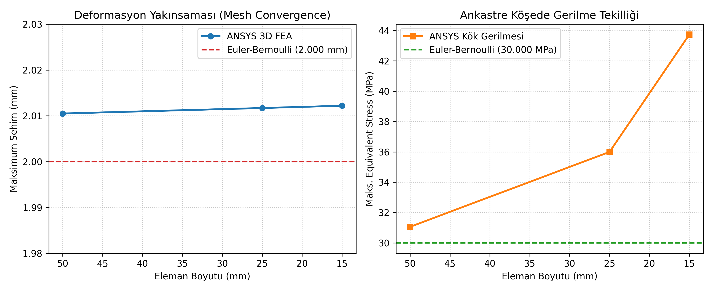
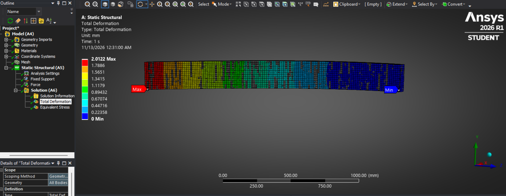
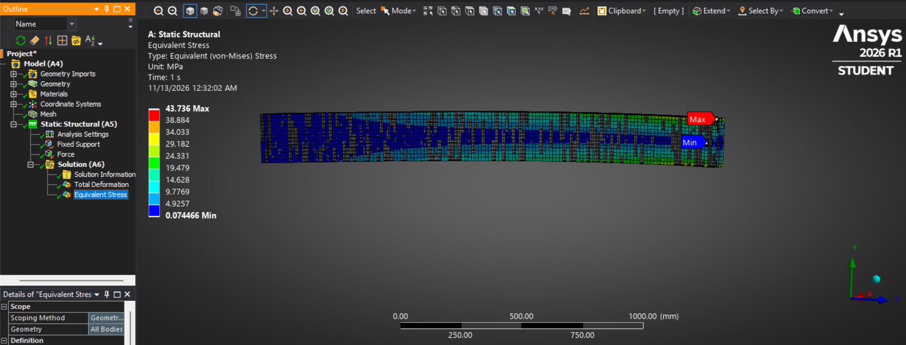

# 3D Cantilever Beam FEA Verification & Mesh Convergence

Verification of a 3D linear elastic finite element model in **ANSYS Workbench 2026 R1** against analytical **Euler-Bernoulli beam theory**, automated with a Python post-processing and visualization script.

## Problem Definition
- **Geometry:** Rectangular cross-section ($b = 100\text{ mm}$, $h = 200\text{ mm}$), Length $L = 2000\text{ mm}$
- **Material:** Structural Steel ($E = 200\text{ GPa}$, $\nu = 0.3$)
- **Boundary Conditions:** Fixed support at $z = 0$; transverse tip load $F_y = -10\text{ kN}$ at $z = 2000\text{ mm}$

## Analytical Reference vs. ANSYS FEA Results

| Method / Element Size | Max Deflection (mm) | Deflection Error | Max von-Mises Stress (MPa) | Stress Error |
| :--- | :---: | :---: | :---: | :---: |
| **Euler-Bernoulli Theory** | `2.0000` | Reference | `30.000` | Reference |
| **ANSYS (`50 mm` mesh)** | `2.0105` | `0.53%` | `31.061` | `3.54%` |
| **ANSYS (`25 mm` mesh)** | `2.0117` | `0.59%` | `35.996` | `19.99%` |
| **ANSYS (`15 mm` mesh)** | `2.0122` | `0.61%` | `43.736` | `45.79%` |

## Key Engineering Findings
1. **Displacement Convergence:** Refining the mesh from `25 mm` to `15 mm` changes tip deflection by only `0.025%`, confirming full mesh convergence. The constant `0.61%` offset above Euler-Bernoulli theory captures transverse shear deformation inherent in 3D solid elements.
2. **Fixed-Boundary Stress Singularity:** While mid-span bending stresses align with the theoretical `30.0 MPa`, peak stress at the fully constrained corner diverges (`31.06 MPa` $\to$ `43.74 MPa`) upon mesh refinement due to geometric and boundary condition singularity.

## Results & Visualization

### Mesh Convergence Analysis

### Total Deformation (`15 mm` Mesh)

### Equivalent von-Mises Stress (`15 mm` Mesh)

